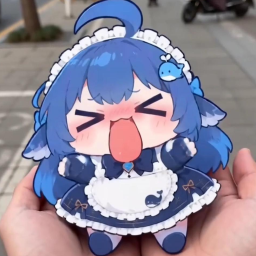

<div align="center">
  

  <h1>AI 队友</h1>
  <p><em>AiTeammate · 让大模型陪你爬塔</em></p>

  <p>
    <b>简体中文</b> | <a href="README_EN.md">English</a>
  </p>

  
</div>

> [!IMPORTANT]
> 本 mod 使用 AI 进行开发，可能会存在错误。

## 安装

1. 下载最新版本 [**Release**](https://github.com/YuWan886/AiTeammate/releases/latest)
2. 安装与游戏版本匹配的 [**RitsuLib**](https://github.com/BAKAOLC/STS2-RitsuLib)
3. 将 `AiTeammate/` 整个文件夹放入游戏目录下的 `mods` 文件夹中
4. 启动游戏，加载器会在日志中打印选择的内容变体
5. 游戏日志在 `%AppData%\SlayTheSpire2\logs\` 文件夹中
6. 可选：[**dsh 外部 Agent**](#外部-agent-接管dsh) 需要额外安装 [`dsh-sts2`](https://github.com/YuWan886/dsh-sts2) 插件

## 支持版本

| 游戏版本 | 支持情况 |
|---|---|
| 0.107.1（正式版） | ✅ 实机验证 |
| 0.111.0（beta） | ✅ 编译/打包验证（需对应版本游戏） |

本 Mod 以 **多版本 bundle** 形式发布：`AiTeammate.dll` 是加载器，实际逻辑在 `lib/<游戏版本>/AiTeammate.Content.dll`，加载器会自动选择匹配当前游戏的版本。

## 功能一览

- **多人联机 · AI 队友**：独立人格、自主投票选路、协作出牌、聊天、查看队友状态（只读）。
- **自定义昵称**：给 AI 队友起名字（设置 → AI 身份）；它自己聊天时或通过 dsh 也能随时改名，名牌、聊天、提示词和联机客户端同步更新。
- **单人 · AI 独自爬塔**：AI 接管本地玩家，选路/战斗/奖励/商店/篝火/事件全自动；你随时能打断它并和它说话。
- **看得懂牌桌**：战斗提示里带手牌、抽牌堆、弃牌堆、消耗堆内容（**不暴露牌序**），还能按需调用只读工具查牌堆、遗物、药水、队友状态、地图路线。
- **视觉模型截图**：可选，让 AI 直接看游戏画面。
- **B 站直播弹幕**：匿名接收弹幕并滚动显示在游戏画面上；登录后可让 AI 挑弹幕回复并发送。
- **外部 Agent 接管**：通过本地桥接让 **dsh（DeepSeek Harness）** 直接操作游戏。
- **每局复盘**：一局结束（通关或阵亡）后自动回顾构筑、路线、遗物与战斗，把胜负原因和下次改进写进该人格的长期记忆。
- **全本地化**：设置页、聊天面板、选人界面、提示消息、内置人格随游戏语言（简体中文 / English）切换。

## 配置

所有设置都在 **游戏内 → 设置 → 模组设置 → AI 队友** 中完成（由 RitsuLib 提供设置页）：

- **AI 引擎**：DeepSeek / OpenAI / Ollama，各自的 API Key、模型、Base URL；模型通过下拉列表选择，先点「获取模型列表」向当前后端查询可用模型（OpenAI 兼容的 `GET /models`，Ollama 用 `/api/tags`）；可选模型思考模式；「连接测试」。
- **决策**：战斗决策超时、聊天超时、非战斗重试次数；是否向 AI 展示抽牌堆/弃牌堆/消耗堆内容；战斗内/战斗外是否允许 AI 主动调用只读工具（牌堆、遗物、药水、队友状态、地图路线等；多人模式下可读队友牌堆）；**允许 AI 查看游戏画面**（截图工具，仅对支持图像输入的视觉模型有效）。
- **人格**：选择/新建/删除人格，编辑背景故事、战斗哲学、交流风格、决策原则；长期记忆与人格成长开关（开启后每局结束会自动复盘并写入记忆）。
- **AI 身份**：自定义 AI 昵称（留空则跟随人格名）；AI 自己在聊天里、或通过 dsh 的 `sts2_set_nickname` 也能改名。
- **聊天**：AI 聊天、聊天气泡、自动发言冷却、提示词聊天历史。
- **维护**：内容缓存自动刷新/手动重建、决策日志与请求日志开关、日志保留数量、打开日志目录、重置全部设置。


## 多人模式

- AI 队友会**独立投票选路**：根据整幕地图、血量、金币和构筑自己决定走向，不再单纯复制人类投的节点；人类投票只在它决策失败/超时时作为兜底，保证不卡住地图。
- 它会按需查看自己的牌堆、遗物、药水，也可以主动查看**队友**的手牌、牌堆、金币、遗物与药水（只读，不会改变任何状态）。抽牌堆顺序不会透露。
- 想减少开销可以在设置里关闭「战斗决策可调用工具」或「战斗外决策可调用工具」。

## AI 独自爬塔（单人模式）

1. **开始方式**
   - 打开「AI 独自爬塔（单人模式）」开关后，**正常开一局单人模式**，AI 会立刻接管本地玩家；
   - 或直接点「开始 AI 独自爬塔」，从主菜单立刻开一局（角色由「AI 角色」选择，默认随机）。
2. **它会做什么**：选路、战斗出牌/用药水、拿奖励与选牌、商店购物、篝火、事件、宝箱、进入下一幕，全部由 LLM 决策自动完成。
3. **随时打断**
   - 在聊天框发消息 = 打断 AI，它会先停下（保留当前回合/当前界面），回复你之后约 3 秒自动继续；
   - 聊天面板标题栏的 **⏸ / ▶** 按钮可以立即暂停或继续（设置页「暂停 / 继续 AI」同效）；
   - 连续发消息会持续延长暂停；暂停期间游戏不会卡死，AI 会等你。
4. **指挥它**：聊天里的指令（如「先打左边」「给我留个药水」）会被解析成战术指令，在接下来的战斗里生效。
5. **兜底**：遇到 Mod 事件特有的小游戏界面时，AI 会等几秒后交给内置的自动处理；实在处理不了会**自动暂停并提示你手动处理**，处理完点 ▶ 继续。

> 单人模式下你仍然是本地玩家：可以随时手动点牌/结束回合（AI 会按自己的节奏继续）。想自己操作时，先点 ⏸ 暂停 AI。

## AI 查看游戏画面（视觉模型）

在设置 → 决策中打开「允许 AI 查看游戏画面」后，AI 在战斗或战斗外决策时可以调用 `screenshot` 工具：模组会把当前游戏画面截成 JPEG（最长边 1024）附加到下一次请求。在聊天里要求它「看看现在画面」时也可以调用（聊天只额外花一轮请求）。只有支持图像输入的模型才能使用；如果模型不支持，接口会报错，AI 会退回普通的文字决策，不会卡住回合。

## B 站直播弹幕

设置页「B 站直播弹幕」分区：

1. **只看弹幕（无需登录）**：填直播间房间号（`live.bilibili.com/` 后面的数字，也可以直接粘贴完整链接），打开「显示直播间弹幕」。模组会以匿名身份连接 B 站弹幕服务器，把弹幕滚动显示在游戏画面上。
2. **显示效果**：默认**只显示在房主屏幕上**、**从左到右**滚动、带头像、每条最多 **50 字**；速度、字号、不透明度、纵向占用比例、方向、头像开关都可以在设置里调整。关闭「只在房主屏幕上显示」后，多人模式的每个客户端会各自连接并显示。
3. **登录后才能发弹幕**：在浏览器打开 B 站并登录，按 F12 → Application/应用 → Cookies → `https://www.bilibili.com`，复制 `SESSDATA` 和 `bili_jct` 两个值，分别粘贴到设置页对应字段，点「验证」会显示账号名。Cookie 以明文保存在本机 RitsuLib 设置文件中，不会上传到任何地方。
4. **AI 和弹幕聊天**：登录后默认允许 AI 回复弹幕（可在设置里关闭）。AI 会读取最近的观众弹幕（可设置每次参考条数），用当前人格和简短游戏状态生成一句回复，并通过你的账号发送到直播间；两次回复之间默认间隔 30 秒，避免刷屏。
5. **限制**：普通账号的弹幕长度通常限制在 20 字以内，发送还受账号等级、直播间禁言/粉丝勋章等规则限制；失败原因会显示在设置页的连接状态和日志中。B 站接口可能触发风控，稍等后会自动重连。

## 外部 Agent 接管（dsh）

让 **dsh（DeepSeek Harness）** 直接操作游戏，而不是把 dsh 当成普通 LLM 后端。

1. 安装 dsh 插件（独立仓库 [YuWan886/dsh-sts2](https://github.com/YuWan886/dsh-sts2) / npm 包 `dsh-sts2`）：

   ```sh
   dsh plugin --profile web add -w dsh-sts2
   ```

   重启 dsh。
2. 在设置页同一分区打开 **启用外部 Agent 桥接**，确认端口（默认 `26333`）与插件一致；需要的话填写访问 token。
3. 开一局**单人模式**（不要同时开启「AI 独自爬塔」），在 dsh 里说：

   > 你来玩这局《杀戮尖塔 2》。先调用 `sts2_autoplay` 打开自动接管，然后一直玩到本局结束。

dsh 会自己完成战斗出牌、地图选路、奖励、商店、篝火、事件与宝箱，直到本局结束。随时可以调用 `sts2_autoplay { "enabled": false }` 或关闭游戏内开关收回控制权。

- 桥接只监听 `127.0.0.1`，不会暴露到局域网/公网。
- 多人局加入 **AI 队友**时，它的选牌/事件/商店/篝火/地图投票也交给 dsh（`controlled.kind=ai`，用 `sts2_decide` 回答）。dsh 连着但没在驱动（比如没开 autoplay、也没人让它干活）时，AI 不会一直等：设置页「dsh 静默回退」默认 30 秒没收到 dsh 请求就改用自带后端，dsh 一恢复调用又自动交回给它。

### 自动接管（AI 队友入局即开新对话）

开着 dsh 的时侯，带 AI 队友的对局不用再手动开口：

1. 对局出现 AI 队友后约 30 秒（留给手动接管的窗口），只要这段时间没有人在驱动，游戏侧就通过 `sts2_takeover` 发出邀请；
2. `dsh-sts2` 插件每 4 秒轮询一次，认领后在 **dsh 里新建一个普通对话**，工作区取设置页里的「工作区」，首条消息取「首条消息」；
3. 新对话和手动新建的完全一样：侧边栏可见、实时输出、随时可以接手打字。

mod 不负责启动 dsh——没有打开的 dsh 就没人认领这个邀请。相关设置：外部 Agent 分区里的「AI 队友入局时自动接管」「工作区」「首条消息」（首条消息支持 `{Host}` `{Port}` `{Token}` `{Workspace}` `{Character}` 占位符）。

- 插件与游戏侧协议见 [`docs/dsh-agent-bridge.md`](docs/dsh-agent-bridge.md)。

## 日志

- 决策日志：`user://ai_teammate/logs/session.log`（默认开启，可在设置中关闭）
- 请求/响应日志：`user://ai_teammate/logs/ai_traffic.log`（默认关闭）
- 设置页「打开日志目录」可直接定位。
  

## 数据与隐私

本 mod **不收集任何统计数据**，没有遥测、没有后台上报。

- 大模型的 API Key 与 B 站 Cookie 以明文保存在本机 RitsuLib 设置文件中，只在你访问对应接口时使用。
- 只有你主动使用 B 站弹幕功能时才会连接 B 站服务器；只有你主动开启外部 Agent 桥接时才会在本机 `127.0.0.1` 上监听端口。

## 交流

- [**QQ: 752913553**](https://qm.qq.com/q/ohYkDqbe7K)
- [**Discord**](https://discord.gg/tJT3a95Y8y)

## 模组联动

- [**RitsuLib**](https://github.com/BAKAOLC/STS2-RitsuLib)：**必需**，设置页与提示由它提供。
- [**海克斯符文（HextechRunes）**](https://www.bilibili.com/video/BV1AE9xByEuM/)：可选软兼容。检测到该 Mod 时，AI 会自己完成海克斯三选一、锻造/遗物选择并确认幕选择（单人爬塔时也会自动点选界面）；未安装时自动跳过。
- **dsh（DeepSeek Harness）+ `dsh-sts2`**：可选，让外部 Agent 直接接管游戏。

## CREDITS

- 框架、设置页与提示 - [RitsuLib](https://github.com/BAKAOLC/STS2-RitsuLib)
- Slay the Spire 2（Mega Crit）
- 外部 Agent 插件 - [dsh-sts2](https://github.com/YuWan886/dsh-sts2)
- B 站直播弹幕 - 基于 B 站公开的直播间 WebSocket 协议实现，非官方接口
